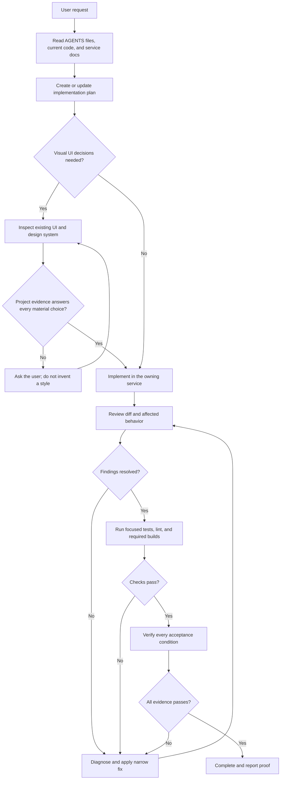

# create-ux-engineer

A dependency-free Go CLI that creates a service-oriented UX engineering workspace or adds a Nuxt frontend to an existing repository.

## Install or upgrade

Linux and macOS users can install the latest release to `$HOME/.local/bin` with the same command used for future upgrades:

```sh
curl -fsSL https://github.com/hainguyen27798/user-experience-engineer-skills/releases/latest/download/install.sh | sh
```

The installer supports amd64 and arm64, verifies the archive's SHA-256 checksum, and atomically replaces an existing binary. Set `CREATE_UX_ENGINEER_INSTALL_DIR` to use another binary directory.

Requires Go 1.27 to build, plus `git` and `npm` at runtime. `uv` is required only when FastAPI is selected.

## Build

```bash
go build -o create-ux-engineer ./cmd/create-ux-engineer
```

Release binaries include their version. Check it with `create-ux-engineer --version`.

The initializer has no Node.js entry point and never invokes `node` or `npx`. Go writes the Nuxt project from embedded scratch templates and invokes `npm install` only for Nuxt's runtime and build dependencies.

## Usage

Create or enter a project directory, then run the binary:

```bash
mkdir my-project
cd my-project
/path/to/create-ux-engineer
```

The current directory base name becomes the project name. The CLI intentionally accepts no path argument, so it cannot scaffold a different directory than the one shown by `pwd`.

An existing `.git` directory or worktree gitfile is preserved, including its history, remotes, hooks, and configuration. The initializer skips `git init` in that case.

Full-stack initialization with `--api` requires an empty worktree. UI-only initialization may run in an existing repository: it preserves existing root and backend files, creates a new `<project>-ui` service plus missing project tooling namespaces, and appends only missing patterns to the existing `.gitignore`. It refuses to run if `<project>-ui` already exists. Root `README.md`, `AGENTS.md`, and release files are generated only for a new workspace so an existing project's identity and commands are not replaced.

Use `create-ux-engineer --api` to create both services or `create-ux-engineer --no-api` for frontend only.

Without `--api` or `--no-api`, the CLI asks whether to create FastAPI with uv.

## Generated workspace

```text
my-project/
├── my-project-ui/       # Nuxt, Nuxt UI, Tailwind CSS, Vitest, ESLint
├── my-project-api/      # FastAPI + uv, only when requested
├── .agents/
│   ├── references/      # Current official Nuxt and Nuxt UI llms-full files
│   └── skills/          # Official and project workflow skills
├── .codex/agents/       # Planner, reviewer, and Cavecrew roles
├── plan/
├── AGENTS.md
├── README.md
├── release.sh
├── skills-lock.json
└── .gitignore
```

The root `release.sh` builds the frontend and, when present, Python distributions into an orphan `release` branch through a temporary Git worktree. Release commits use `release YYYY/MM/DD HH:mm` in UTC.

The generated root and service-level `AGENTS.md` files define folder ownership so coding agents keep Nuxt routes, components, composables, layouts, FastAPI transport, domain modules, infrastructure adapters, and tests in consistent locations. Service READMEs include the same compact structure maps; directories are created only with their first real file.

See [`docs/installed-components.md`](docs/installed-components.md) for the complete manifest of direct frontend and backend libraries, generated agent profiles, official skills, workflow skills, and downloaded references.

## Official latest skills

The CLI shallow-clones the current default-branch HEAD directly from:

- [`JuliusBrussee/caveman`](https://github.com/JuliusBrussee/caveman)
- [`nextlevelbuilder/ui-ux-pro-max-skill`](https://github.com/nextlevelbuilder/ui-ux-pro-max-skill)
- [`Leonxlnx/taste-skill`](https://github.com/Leonxlnx/taste-skill), installed as `design-taste-frontend`

It copies each listed skill directory unmodified and writes the resolved commit plus a deterministic directory hash to `skills-lock.json`. No Skills CLI or `npx` is involved.

Seven project workflow skills are embedded from `templates/skills/`. Visual workflow routing can use both UI UX Pro Max and Taste. Generated repository instructions require Taste screenshots, browser profiles, reports, caches, previews, and history to stay in an OS temporary directory; only explicit user deliverables may be kept in a service-owned path.

## Generated workspace workflow

Run commands from the generated workspace root unless a service README says otherwise. The workflow is evidence-first: inspect the repository, keep one current plan for non-trivial work, use only the skill for the active stage, and prove the requested result before stopping.



### 1. Start from repository evidence

Before editing:

1. Read the workspace root `AGENTS.md`.
2. Read `<project>-ui/AGENTS.md` and `<project>-ui/docs/design-system.md` for frontend work.
3. Read `<project>-api/AGENTS.md` for backend work when the API exists.
4. Inspect the closest implementation, test, component, layout, module, and configuration patterns.
5. Check `skills-lock.json` when the task depends on an official skill's exact source revision.

Do not create empty folder trees. Create a folder only with its first real owned file. Keep UI and API code inside their service directories and integrate them through an explicit HTTP contract rather than cross-importing implementation code.

### 2. Create and maintain the plan

For every non-trivial frontend change, load `.agents/skills/create-implementation-plan/SKILL.md` before editing. Use the same skill for planned backend or cross-stack work:

- Frontend plans use the `fe` scope and paths under `<project>-ui/`.
- Backend plans use the `be` scope and paths under `<project>-api/`.
- Use exactly one plan for all work intended to land in one commit or pull request. Cross-stack work stays in that one plan and uses the scope of the primary requested outcome.
- Plans live in `plan/` and must name concrete files, completion conditions, checks, risks, and dependencies.
- Update the active plan when new evidence changes scope, assumptions, ownership, or required proof.

Small explanation-only requests and obvious edits can skip a plan. They still require repository inspection and proportionate verification.

### 3. Design visual work from the existing product

Load `.agents/skills/design-frontend-ui/SKILL.md` only when the request changes layout, appearance, responsive behavior, interaction, or accessibility.

The existing product is authoritative. Match its layout, color roles, fonts, type sizes, spacing, sizing, radius, borders, shadows, responsive behavior, motion, and interaction states. Reuse Nuxt UI components and current semantic tokens before adding custom primitives.

UI UX Pro Max and Taste provide analysis and checks; they do not authorize a generic redesign. Brief both with the current approved color palette and semantic token mapping, and reject or remap colors outside that palette. When current screens, components, tokens, and `docs/design-system.md` do not answer a material choice, ask the user. Record approved reusable decisions in `docs/design-system.md`; keep one-off task exceptions in the active plan.

Taste and browser/design inspection output must stay in an OS temporary directory outside the repository. Persist only a file the user explicitly requests, in the documented path owned by the relevant service.

### 4. Implement at the owning layer

For planned frontend work, load `.agents/skills/implement-frontend-change/SKILL.md` and implement the next incomplete plan step.

| Area | Owner |
| --- | --- |
| Nuxt routes | `<project>-ui/app/pages/` |
| Reusable UI | `<project>-ui/app/components/` |
| Stateful Vue and API orchestration | `<project>-ui/app/composables/` |
| Shared page shells | `<project>-ui/app/layouts/` |
| Source styles and bundled assets | `<project>-ui/app/assets/` |
| Static files served unchanged | `<project>-ui/public/` |
| Nuxt-only server behavior | `<project>-ui/server/` |
| FastAPI composition root | `<project>-api/src/<api_module>/main.py` |
| HTTP transport | `<project>-api/src/<api_module>/api/` |
| Domain behavior | `<project>-api/src/<api_module>/modules/<feature>/` |
| External adapters | `<project>-api/src/<api_module>/infrastructure/` |
| Backend cross-cutting primitives | `<project>-api/src/<api_module>/core/` |

Keep authentication, authorization, persistence, and cross-client domain rules in FastAPI when the backend exists. Preserve Nuxt SSR, semantic HTML, keyboard access, visible focus, contrast, and client-only boundaries.

### 5. Review, test, and verify

Use one stage skill at a time:

| Stage | Project skill | Typical specialist routing |
| --- | --- | --- |
| Plan | `create-implementation-plan` | `caveman-explore`, `lean-build`, `migration` |
| Design | `design-frontend-ui` | `ui-ux-pro-max`, `design-taste-frontend` |
| Implement | `implement-frontend-change` | `lean-build`, `safe-refactor`, `migration` |
| Review | `review-frontend-change` | `caveman-review`, UI skills for visual diffs |
| Test | `test-frontend-change` | Repository commands and focused tests |
| Verify | `verify-frontend-change` | `verify-and-stop` |
| Fix | `fix-frontend-bug` | `investigate-first`, `surgical-patch`, `safe-refactor` |

The generated Codex profiles can narrow the work further: `planner` plans, `reviewer` performs read-only review, `cavecrew-investigator` locates code, `cavecrew-builder` handles a clearly assigned one- or two-file change, and `cavecrew-reviewer` reports compressed findings.

Run the narrowest relevant check first, then the affected service gate:

```bash
# Frontend
npm --prefix <project>-ui run lint
npm --prefix <project>-ui run build

# Backend, when present
uv sync --project <project>-api
uv run --project <project>-api ruff check --config <project>-api/pyproject.toml <project>-api
uv run --project <project>-api ruff format --check --config <project>-api/pyproject.toml <project>-api
uv run --project <project>-api mypy --config-file <project>-api/pyproject.toml <project>-api/src
uv run --project <project>-api python -m compileall <project>-api/src
```

Run additional tests defined by the service when they cover the change. Report each required check as pass, fail, unavailable, or blocked. Verification is complete only when every requested behavior and plan proof item passes; otherwise record the failure and return through `fix-frontend-bug` to review and testing.

### Example request

```text
Add a responsive account settings screen and its profile API. Inspect the existing
layout and design tokens first, keep frontend and backend work in one plan, preserve the
current visual language, implement through an explicit HTTP contract, then review,
test, and verify every acceptance condition before stopping.
```

## Development

```bash
go test ./...
go test -race ./...
go build ./cmd/create-ux-engineer
```

Routine tests are offline and mock npm, uv, GitHub clones, and framework downloads.

## Publish a CLI release

From a clean `main` checkout, run:

```bash
./release.sh
```

This runs tests, race tests, and vet; increments the patch number in `VERSION`; locally cross-builds Linux and macOS archives for amd64 and arm64; creates a release commit and annotated tag; atomically pushes `main` and the tag to `origin`; then publishes the files with the authenticated GitHub CLI. It requires `go`, `git`, and `gh`.

If a push or GitHub asset upload fails, rerunning the script resumes that same version and fills in any missing release assets instead of incrementing again. Ordinary `go build` never changes `VERSION`; no GitHub Actions workflow is involved.

## Security and licenses

This project is MIT licensed. See [`LICENSE`](LICENSE) and [`SECURITY.md`](SECURITY.md). Official skills are downloaded at initialization time and remain subject to their upstream licenses; review `skills-lock.json` and upstream terms before redistribution.
